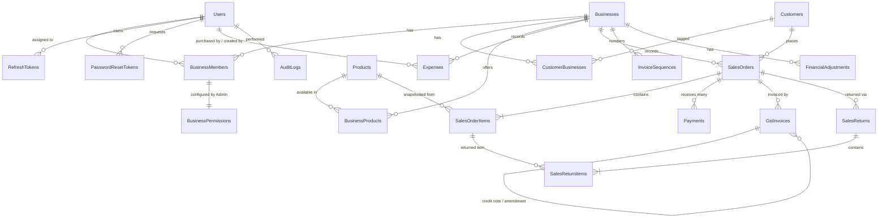

# Entity Relationship Diagram (approval draft)

Renders natively on GitHub. Source: `Database/ERD/erd.mmd`. Full DDL: `Database/Schema/001_schema.sql`.

## Design notes
- **Users** holds Admin, Member and Employee (role column). A filtered unique index guarantees exactly one Admin. *Deviation from FRD s.14, which lists a separate Admin table - needs approval.*
- **Access vs capability:** `BusinessMembers` grants access; `BusinessPermissions` (1:1) holds explicit boolean capabilities incl. `CanViewMemberWiseExpenses`.
- **Snapshots:** `SalesOrderItems` stores name/price/GST/HSN; `GstInvoices.SnapshotJson` freezes business + customer + lines.
- **Payments** are separate rows, never hard-deleted (`Status` Valid/Reversed). Payment status and outstanding come from `vw_SalesOrderPaymentSummary`, not stored columns.
- **Invoice numbering:** `InvoiceSequences` (per business + financial year + doc type), incremented inside the issuing transaction with a row lock.
- **Soft delete:** `IsDeleted` + audit columns on financial/master records; `AuditLogs` records old/new values.
- **Proposed additions (not in FRD s.14):** `SalesReturns`, `SalesReturnItems`, `InvoiceSequences`, `RefreshTokens`, `PasswordResetTokens`, plus columns `Customers.StateCode/Gstin`, `Products.HsnCode`, `Expenses.InputGstAmount/IsInputGstEligible`, `Businesses.AddressLine/StateCode`.
